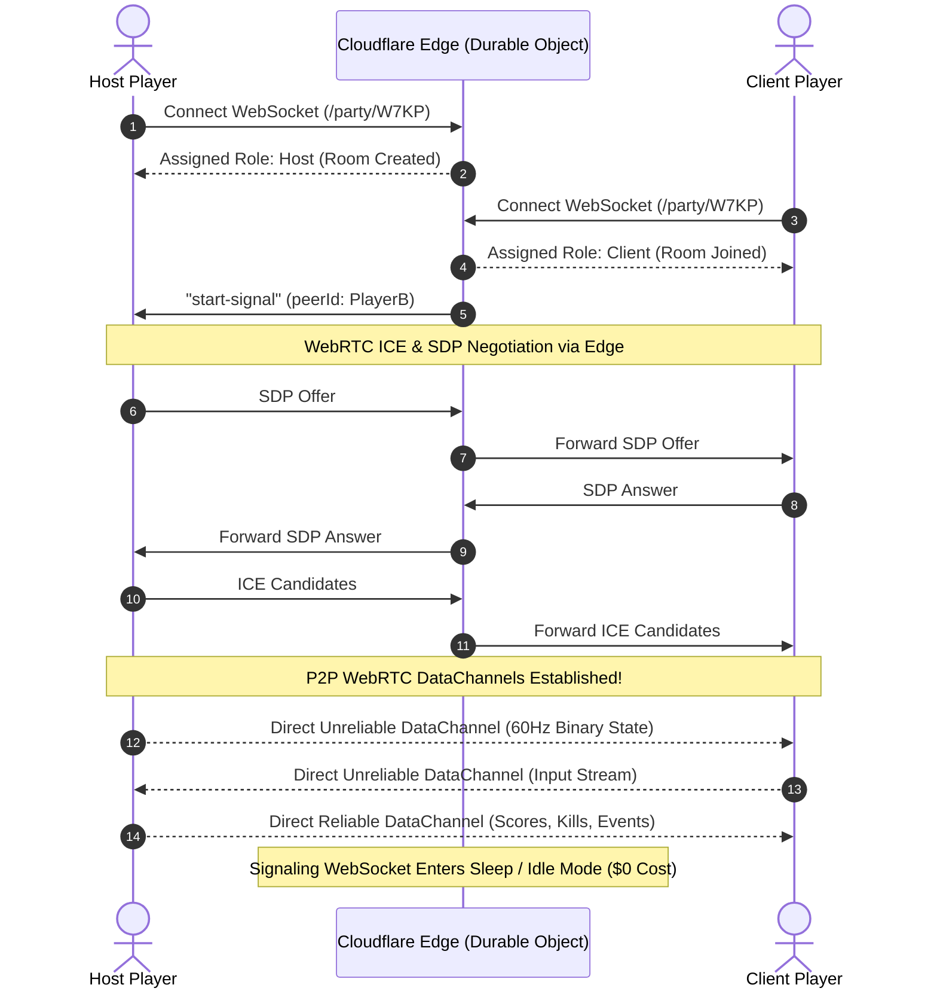

# Mereb Manual: Architecture & Core Engine

> **Version:** 2026.1 LTS &nbsp;|&nbsp; **Verified Platforms:** WebGL, HTML5, Godot 4, Unity 3D, Node.js, React &nbsp;|&nbsp; [Switch to Scripting API](../api/SCRIPTING_REFERENCE.md)

---

## 1. What is Mereb?

**Mereb** is an ultra-lightweight (13 kB gzipped), zero-cost multiplayer netcode and matchmaking engine designed specifically for modern web games, web game portals (**Poki**, **CrazyGames**), mobile web browsers, indie game engines (**Godot 4**, **Unity WebGL**, **Three.js**, **Phaser 3**), and React applications.

Traditional multiplayer architectures require dedicated game servers (VPS instances or container fleets on AWS, Agones, or Hathora) running 24/7. These dedicated instances accrue massive monthly infrastructure bills ($150 to $2,000+/month) even when player counts are low or fluctuating. 

**Mereb eliminates dedicated server costs completely ($0/month)** by combining:
1. **Serverless Edge Signaling & Matchmaking**: Lightning-fast room creation and global matchmaking executed at the Cloudflare Edge (using Cloudflare Workers + Durable Objects with SQLite storage) or PartyKit.
2. **Direct Peer-to-Peer WebRTC DataChannels**: Authoritative 60Hz physics and game state streams directly between players over peer-to-peer UDP data channels with sub-15ms direct transit latency.
3. **Pro-Grade Netcode Tooling**: Built-in 85% binary serialization (`defineSchema`, `BinaryWriter`, `BinaryReader`), Hermite snapshot interpolation, and dead reckoning to eradicate jitter.
4. **Zero-Bounce Smart Bot Fallback**: An automatic 8-second matchmaking countdown that seamlessly spins up an offline local bot if no human peer is available, ensuring matchmaking queues never feel abandoned.
5. **Web Portal Ad Resilience**: Automatic freeze protection for Poki SDK and CrazyGames SDK rewarded breaks and commercial interstitials, eliminating WebRTC disconnects during video ads.

---

## 2. High-Level Architecture & Topology

Mereb utilizes a **Host-Authoritative WebRTC Mesh Topology** orchestrated by serverless edge workers:

```
                            [ Cloudflare Edge Mesh ]
                  (Workers + Durable Objects + SQLite Storage)
                      Global Presence, Matchmaking & Signaling
                                 ▲              ▲
                       WebSocket │              │ WebSocket
                      (Signaling)│              │ (Signaling)
                                 │              │
           ┌─────────────────────┴──────────────┴─────────────────────┐
           │                                                          │
     [ Host Player ] <════════════════════════════════════════> [ Client Peer ]
     • Authoritative Physics               WebRTC DataChannel     • Local Input Capture
     • 60Hz Binary State Broadcast           (Sub-15ms UDP)       • Client Prediction
     • Damage & Collision Check                                   • Hermite Interpolation
     • Fallback Bot Simulation (if solo)                          • RTT Ping & Jitter Probe
```

### Network Lifecycle Flowchart



---

## 3. Dual DataChannel Architecture

Unlike basic WebSocket wrappers that force all traffic through a single ordered TCP stream (causing head-of-line blocking whenever a single packet drops), Mereb creates **two isolated WebRTC DataChannels** between connected peers:

| Channel Identifier | Transport Protocol | Ordered | Max Retransmits | Intended Game Traffic |
| :--- | :--- | :--- | :--- | :--- |
| **`unreliable`** | UDP-like (SCTP) | `false` | `0` | High-frequency position (x, y, z), velocity, rotation, health, aiming vectors, and client movement inputs (60Hz). |
| **`reliable`** | TCP-like (SCTP) | `true` | Guaranteed delivery | Match start, player deaths, kills, round timers, game over events, chat messages, and score mutations. |

> [!NOTE]
> By decoupling high-frequency entity telemetry into the `unreliable` channel, packet loss on patchy mobile or Wi-Fi connections never stalls your render loop. Dropped snapshots are simply superseded by newer ones.

---

## 4. Host-Authoritative Simulation vs Client Prediction

Mereb enforces an authoritative game simulation model:
- **Host Role**: The player who initiates or receives priority in the room runs the authoritative game loop (physics resolution, projectile hits, collisions, score calculations). The host broadcasts state snapshots at regular intervals (typically 20Hz to 60Hz).
- **Client Role**: The connecting peer samples user inputs (WASD, mouse aim, touch controls) and transmits them up to the host. Concurrently, the client applies **client-side prediction** to their local player and uses Mereb's `SnapshotInterpolator` to render the host's remote entity with smooth Hermite spline interpolation.
- **Bot Fallback Mode**: If matchmaking exceeds the configured timeout (`botTimeoutMs: 8000`), the local client seamlessly transitions to host role and spawns a local AI proxy. The game loop runs identically, providing zero-friction instant gameplay.

---

## 5. Security & NAT Traversal (Multi-TURN Relay Pool)

Peer-to-peer WebRTC connections encounter diverse NAT configurations:
1. **Full Cone & Restricted Cone NATs**: Successfully connected via STUN in <100ms with zero relay overhead (approx. 86% of residential connections).
2. **Symmetric NATs (University dorms, enterprise VPNs, school Wi-Fi)**: Cannot establish direct P2P socket pairs. Mereb provides a **Multi-TURN Relay Pool** (Google STUN, Cloudflare STUN, and secure TLS TURN over Port 443 via OpenRelay or custom Coturn) to ensure 99.9% connection success globally.

---

## 6. Next Steps

- Proceed to [Quickstart & Setup](02_QUICKSTART_AND_SETUP.md) to integrate Mereb in 5 minutes.
- Review [Why Mereb is Better (Benchmarks & Comparison)](03_WHY_MEREB_IS_BETTER_BENCHMARKS.md) to compare Mereb against Photon, Hathora, and Agones.
- Inspect the [Scripting API Reference](../api/SCRIPTING_REFERENCE.md) for full method definitions.
